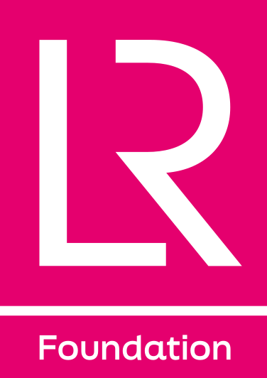

  

# Lloyd’s Register Foundation

Lloyd’s Register Foundation is an independent global safety charity with a mission to engineer a safer world. We support research, innovation and education to make the world a safer place, and we share the evidence, data and tools that come out of that work.

This GitHub organisation is where the Foundation publishes open data and the code behind its public tools. It belongs to the whole Foundation. At present most of the work here comes from the [Global Safety Evidence Centre](https://www.lrfoundation.org.uk/gsec/the-global-safety-evidence-centre), which is its main user.

## About the Foundation

Our [strategy](https://www.lrfoundation.org.uk/about-us/strategy) focuses our resources on three connected priority areas.

| Priority area | What it covers |
| :--- | :--- |
| [Safer maritime systems](https://www.lrfoundation.org.uk/our-priorities/safer-maritime-systems) | Safety across the maritime system as part of building a sustainable ocean, including decarbonisation, digitalisation and the effects of climate change |
| [Safer sustainable infrastructure](https://www.lrfoundation.org.uk/our-priorities/safer-sustainable-infrastructure) | Making sure critical infrastructure is safe, resilient and fit for purpose as the needs of society change |
| [Skilled people for safer engineering](https://www.lrfoundation.org.uk/our-priorities/skilled-people-for-safer-engineering) | Increasing the number and diversity of skilled engineers, especially in the parts of the world where they are most needed |

We also invest in two centres that hold the Foundation’s own assets and expertise.

| Centre | What it does |
| :--- | :--- |
| [Global Safety Evidence Centre](https://www.lrfoundation.org.uk/gsec/the-global-safety-evidence-centre) | Collates, creates and communicates the best available evidence on the nature and scale of global safety challenges, and on what works to address them |
| [Heritage Centre](https://heritage.lrfoundation.org.uk/) | Home to the world’s largest open-access maritime archive, preserving and sharing maritime and engineering history to help shape a safer, sustainable ocean economy |

Our most direct means of achieving our mission is through [grants](https://www.lrfoundation.org.uk/partnerships-and-funding/grant-funding) to research and education organisations around the world. The Foundation’s income comes from dividends on its investments and from Lloyd’s Register Group, a global provider of safety services, which the Foundation owns.

## Open data and tools

| Resource | What it is |
| :--- | :--- |
| [World Risk Poll](https://www.lrfoundation.org.uk/wrp) | The first and only global study of worry about, and harm from, risks to people’s safety. Four waves from 2019 to 2025, with more than 570,000 people interviewed in up to 142 countries and areas |
| [World Risk Poll data](https://github.com/lrfoundation/world_risk_poll_data) | Respondent-level data from every wave of the Poll, free to download and reuse with attribution |
| [World Risk Poll Data Explorer](https://tools.gsec.org.uk/wrp-explorer.html) | Maps, ranks and compares every wave by country and demographic group in the browser, with no download or code needed |
| [Global Safety Evidence Centre tools](https://tools.gsec.org.uk/) | Free chart, map and report builders in the Foundation style, alongside the Data Explorer |
| [Foundation Knowledge Repository](https://repo.gsec.org.uk/) | A searchable library of Foundation outputs: reports, evidence reviews, World Risk Poll publications and data |
| [Heritage Centre archive](https://heritage.lrfoundation.org.uk/) | More than 1.1 million documents, ship plans and survey reports, free to search and view online, including Lloyd’s Register of Ships from 1764 to 2000 |

## Public repositories

| Repository | What it holds |
| :--- | :--- |
| [world_risk_poll_data](https://github.com/lrfoundation/world_risk_poll_data) | Harmonised World Risk Poll microdata for 2019, 2021, 2023 and 2025 in SPSS, Parquet and CSV, with a data dictionary and methodology report for each wave and worked examples in Python, R, SQL and Julia. Licensed under [CC BY-SA 4.0](https://github.com/lrfoundation/world_risk_poll_data/blob/main/LICENSE) |

If you use our data, please cite it. The World Risk Poll data repository includes a `CITATION.cff` file, so GitHub shows a ready-made citation under **Cite this repository** on its main page.

## Contact

- General enquiries: [info@lrfoundation.org.uk](mailto:info@lrfoundation.org.uk)
- Grants, media, the Heritage Centre, the Global Safety Evidence Centre or the World Risk Poll: the [contact page](https://www.lrfoundation.org.uk/contact-us) sends each enquiry to the right team
- Heritage Centre: [heritage@lrfoundation.org.uk](mailto:heritage@lrfoundation.org.uk)
- News and updates: [news](https://www.lrfoundation.org.uk/news), the [newsletter](https://www.lrfoundation.org.uk/newsletter-sign-up), [LinkedIn](https://uk.linkedin.com/company/lloyd%27s-register-foundation) and [YouTube](https://www.youtube.com/@LloydsRegisterFoundation)

---

Lloyd’s Register Foundation is a Registered Charity (Reg. no. 1145988) and limited company (Reg. no. 7905861) registered in England and Wales, and owner of Lloyd’s Register Group Limited. [Website](https://www.lrfoundation.org.uk/) · [Privacy notice](https://www.lrfoundation.org.uk/privacy-notice) · [ROR 057q4mw47](https://ror.org/057q4mw47)
